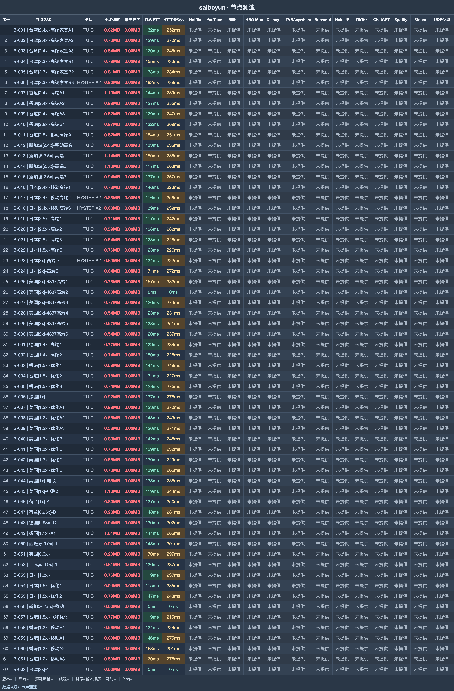

# 赛博云价格与套餐怎么选｜3 元月付、8 元按量，哪档更划算（2026-11-27 更新）

> **价格结论先说：**固定每月使用，先买 **3 元/月 120G** 的轻量套餐；用量断断续续、不想按月清零，先看 **8 元一次付 100G**；多设备并用或需要更高限速，再比较 **12 元/月 750G** 的进阶套餐。
>
> 👉 **[官网注册](https://saiboyun.org/#/register?code=dAvrmHqg)** · 不确定线路是否合用，先从 3 元月付开始，试过常用节点再升级。

## 赛博云价格速览

| 预算或用量 | 优先看哪档 | 价格 | 买到什么 | 为什么先看它 |
|---|---|---:|---|---|
| 最低月付预算 | 轻量套餐 | **3 元/月** | 120G、5 台、60M | 首次成本最低，适合先验证线路 |
| 6 元月预算 | 入门套餐 | **6 元/月** | 320G、6 台、150M | 相比轻量档同时增加流量、设备数和限速 |
| 多设备、大月流量 | 进阶套餐 | **12 元/月** | 750G、9 台、300M | 是设备数和限速明显提高的中间档 |
| 用量不固定 | 按量付费 100G | **8 元一次付** | 100G、150M | 不按月清零，适合低频使用 |
| 一次囤更多流量 | 按量付费 1000G | **68 元一次付** | 1000G、300M | 比反复买 100G 包更省单价 |

**最简单的买法：**第一次使用，不要因为年付或大流量数字直接提高预算。先用 3 元月付核对常用地区、倍率和设备体验；确认会长期持续使用，再比较更长周期。只有使用频率不固定，才把按量包放到月付前面。

**适合：**

- 想用 3 元控制第一次试用成本。
- 每月持续使用，希望在 3～28 元常规月付档里逐级加流量。
- 使用频率不固定，需要不清零的按量包。
- 有多设备需求；3 元档已经允许 5 台共用。

**不适合：**

- 准备在 3 元档直接使用高端线路或客服支持，该档不包含这两项。
- 不愿根据倍率管理流量；节点倍率范围为 0.9x～2.8x。
- 希望所有套餐限速相同，限速会随档位变化。

## 核心购买指标

| 选购项 | 内容 |
|---|---|
| 起步价 | 3 元/月 120G |
| 按量起点 | 8 元一次付 100G，不清零 |
| 节点记录 | 62 个，59 个连通 |
| 延迟中位 | 134 ms |
| 速度中位 | 6.3 MB/s |
| 最快平均速度 | 9.3 MB/s |
| 计费倍率 | 0.9x – 2.8x |
| 套餐限速区间 | 60 – 500 Mbps |
| 入门设备数 | 3 元档支持 5 台 |
| 协议组合 | TUIC / Hysteria2 / anyTLS |

## 全部套餐价格表

### 周期套餐：适合每月持续使用

| 套餐名称 | 流量 | 设备 | 限速 | 月付 | 季付 | 半年 | 年付 | 两年 | 三年 |
|---|---:|---:|---:|---:|---:|---:|---:|---:|---:|
| 轻量套餐 | 120G | 5 | 60M | **3 元** | 8.65 | 16.50 | 30 | 57 | 81 |
| 入门套餐 | 320G | 6 | 150M | **6 元** | 17.50 | 33 | 60 | 114 | 162 |
| 基础套餐 | 520G | 7 | 200M | **9 元** | 25.90 | 49.50 | 90 | 171 | 243 |
| 进阶套餐 | 750G | 9 | 300M | **12 元** | 34.50 | 66 | 120 | 228 | 324 |
| 高级套餐 | 1066G | 11 | 400M | **16 元** | 46 | 88 | 160 | 304 | 432 |
| 豪华套餐 | 2077G | 16 | 500M | **28 元** | 81 | 154 | 280 | 532 | 756 |
| 超级套餐 | 3088G | 22 | 不限 | **42 元** | 121 | 231 | 420 | 798 | 1134 |
| 究极套餐 | 5099G | 27 | 不限 | **69 元** | 198 | 379 | 690 | 1311 | 1863 |

月付套餐约为 **40～74 GB/元**。不要只按流量单价选：设备数、限速、线路范围与节点倍率也会改变实际体验。

### 按量套餐：适合用量波动

| 套餐名称 | 流量 | 限速 | 一次付 |
|---|---:|---:|---:|
| 按量付费 100G | 100G | 150M | **8 元** |
| 按量付费 500G | 500G | 200M | **38 元** |
| 按量付费 1000G | 1000G | 300M | **68 元** |
| 按量付费 2000G | 2000G | 400M | **128 元** |
| 按量付费 5000G | 5000G | 不限 | **298 元** |

按量包越大，表内总价与流量一起提高；第一次购买仍应按真实用量选，不为囤量买用不完的额度。

### Netflix 组合套餐

| 套餐名称 | 流量 | 设备 | 限速 | 季付 | 半年 |
|---|---:|---:|---:|---:|---:|
| 奈飞体验套餐：Netflix 五人车 + 320G | 320G | 14 | 不限 | 104 | 206 |
| 奈飞轻量套餐：Netflix 五人车 + 520G | 520G | 16 | 不限 | 112 | 222 |
| 奈飞高级套餐：Netflix 五人车 + 1066G | 1066G | 18 | 不限 | 131 | 260 |

## 按预算和用量怎么选

### 预算 3～6 元：先验证，不提前锁长周期

3 元轻量档已经包含 120G、5 台设备与 60M 限速，适合第一次验证。需要更高限速、更多流量，或要从 6 元档开始查看 IEPL 专线，再升级到 6 元入门档。表内 60M 是轻量档的购买判断口径，不采用旧建议中出现过的 70Mbps。

### 每月流量超过 500G：比较 9 元、12 元与 16 元档

- 9 元基础档：520G、7 台、200M。
- 12 元进阶档：750G、9 台、300M。
- 16 元高级档：1066G、11 台、400M。

这三档的差异不仅是流量；设备数和限速同步上升。先按同时在线设备数排除不够用的档位，再比较流量。

### 月份之间用量差异大：按量包优先

100G 按量包 8 元，500G 为 38 元，1000G 为 68 元，均为一次付且不清零。它们的每 GB 价格高于多数月付档，购买理由是使用周期灵活，不是绝对流量单价最低。

## 套餐陷阱与限制

1. **月付与按量不能只按同一张“每元流量”榜排序。** 月付便宜但有周期；按量包更贵，换来不清零。
2. **节点倍率会改变实际扣量。** 0.9x、0.95x、1x 节点更适合流量敏感用户；2.4x、2.5x 高端节点会更快消耗额度。
3. **3 元档有明确边界。** 不含高端线路与客服支持；需要 IEPL 专线从 6 元档查看。
4. **高档限速栏的含义要按表读取。** 42 元及 69 元两档写“不限”，不要把它外推成任意环境都能达到固定速度。
5. **不存在本文已核的优惠码或限时折扣。** 表中的季付、半年、年付与多年价格是套餐周期价，不称额外优惠。

## 测速能为购买说明什么

留存测试共有 **62 行节点**，其中 **59 个连通**；延迟中位 **134 ms**、速度中位 **6.3 MB/s**，最快节点平均速度 **9.3 MB/s**。测试时间为 **2026-10-17 18:26–18:39**，环境为中国大陆家宽出口香港，每节点连测 **3 次取最优**。

| 节点名称 | 协议类型 | 延迟 | 完整请求 | 平均速度 | 最高速度 |
|---|---|---|---|---|---|
| 新加坡[2.5x]-高端1 | TUIC | 159ms | 237ms | **9.30 MB/s** | 11.14 MB/s |
| 新加坡[2.5x]-高端2 | TUIC | 120ms | 282ms | **9.09 MB/s** | 11.06 MB/s |
| 香港[2.4x]-高端A1 | TUIC | 141ms | 245ms | **9.02 MB/s** | 11.10 MB/s |
| 美国[1x]-电联2 | TUIC | 118ms | 241ms | **9.01 MB/s** | 11.15 MB/s |
| 德国[1.1x]-A1 | TUIC | 144ms | 293ms | **8.35 MB/s** | 12.62 MB/s |
| 香港[2.4x]-高端A2 | TUIC | 124ms | 260ms | **8.15 MB/s** | 13.23 MB/s |
| 荷兰[0.95x]-B | TUIC | 152ms | 286ms | **8.06 MB/s** | 10.40 MB/s |
| 美国[1.2x]-优化A1 | TUIC | 121ms | 263ms | **8.04 MB/s** | 11.13 MB/s |

地区记录为美国 15、香港 13、日本 12、台湾 7、新加坡 5、德国 4、荷兰 2，法国、西班牙、英国、土耳其各 1。该次测速用于缩小候选，不是长期速度或任意网络环境保证。

## 购买前核对

- [ ] 先决定持续月付还是用完为止，不把两种产品混成同一价格。
- [ ] 核对准备使用的节点倍率，把倍率计入流量预算。
- [ ] 核对设备数和限速是否覆盖自己的同时在线场景。
- [ ] 若要高端线路、客服或 IEPL，不买错 3 元档。
- [ ] 下单页再次确认价格、周期与套餐名称；本文不承诺未核实的实时库存或额外优惠。

## 赛博云价格 FAQ

### 赛博云最低多少钱？

最低月付为 **3 元/月 120G**；最低按量包为 **8 元一次付 100G**。两者周期不同，不能只按总价判断谁更便宜。

### 3 元、6 元和 12 元怎么选？

第一次试线选 3 元；需要 150M 限速、320G 和 6 台设备，比较 6 元档；多设备并用或需要 750G、300M，再看 12 元档。

### 年付是不是优惠活动？

本文只确认各周期价格，不把年付价称为限时优惠，也没有已核优惠码。是否选长周期，取决于你是否已经用月付验证过线路。

### 按量包真的更划算吗？

按量包的优势是不清零，而不是每 GB 一定更便宜。每月持续使用通常先比较月付；使用间隔长、用量波动大，再选按量。

### 赛博云怎么买更稳妥？

先通过下方入口注册，从最低能覆盖需求的档位购买。第一次优先 3 元月付；试过常用节点、倍率与设备使用后再升级或拉长周期。

## 注册与购买

👉 **[官网注册](https://saiboyun.org/#/register?code=dAvrmHqg)** · 先买能覆盖需求的最低档，月付试过线路后再考虑长周期或更高档。

## 重要更新

- **2026-11-27** — 每日复核：套餐、价格与公告无变化；多账号发布对齐核查完成。
- **2026-11-26** — 每日复核：套餐、价格与公告无变化；多账号发布对齐核查完成。
- **2026-11-25** — 每日复核：套餐、价格与公告无变化；多账号发布对齐核查完成。
- **2026-11-24** — 每日复核：套餐、价格与公告无变化；多账号发布对齐核查完成。
- **2026-11-23** — 每日复核：套餐、价格与公告无变化；多账号发布对齐核查完成。
- **2026-11-22** — 每日复核：套餐、价格与公告无变化；多账号发布对齐核查完成。
- **2026-11-21** — 每日复核：套餐、价格与公告无变化；多账号发布对齐核查完成。
- **2026-11-20** — 每日复核：套餐、价格与公告无变化；多账号发布对齐核查完成。
- **2026-11-19** — 每日复核：套餐、价格与公告无变化；多账号发布对齐核查完成。
- **2026-11-18** — 重构为价格、套餐与购买决策版本；套餐价格沿用当日已复核内容。
- **2026-10-18** — 已有价格复核记录显示轻量档仍为 3 元，公告记录未新增。
- **2026-10-17** — 留存全节点测试：59/62 连通，延迟中位 134ms，最快平均速度 9.3 MB/s。

---
*测速记录日期 2026-10-17 18:26–18:39，中国大陆家宽出口香港，每节点连测 3 次取最优。价格与套餐以商家实时显示为准。*
