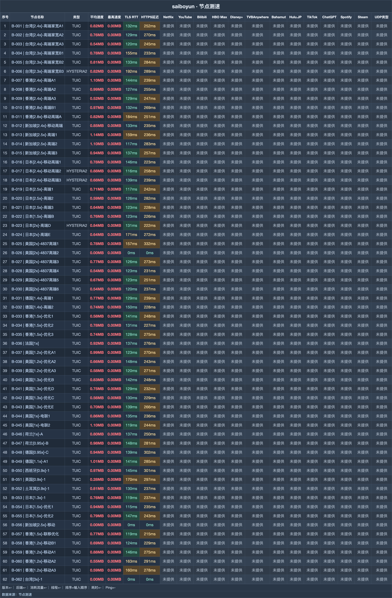

# 赛博云机场｜120G 月付 3 元，周期包与按量包分开选（2026-11-12 更新）

> **一句话评价：从 3 元 120G 入门，16 档覆盖常用月付、按量付费与奈飞组合，重点是按自己的用量选。**
>
> 👉 **[官网注册](https://saiboyun.org/#/register?code=dAvrmHqg)** · 月付预算先放在 3 元档，试过线路再决定是否提高档位。

**适合：**

- 想把订阅开销压低，同时保留较大的流量额度。
- 使用频率不固定，倾向购买不会清零的按量包。
- 有多设备需求；3 元档已经允许 5 台共用。

**不适合：**

- 准备在 3 元档直接使用高端线路或客服支持，该档不包含这两项。
- 希望所有套餐都提供相同限速，赛博云的速度上限会随档位变化。

| 选购项 | 内容 |
|---|---|
| 起步价 | 3 元/月 120G |
| 节点记录 | 62 个，59 个连通 |
| 延迟中位 | 134 ms |
| 速度中位 | 6.3 MB/s |
| 最快平均速度 | 9.3 MB/s |
| 计费倍率 | 0.9x – 2.8x |
| 套餐限速区间 | 60 – 500 Mbps |
| 入门设备数 | 3 元档支持 5 台 |
| 协议组合 | TUIC / Hysteria2 / anyTLS |

**关于赛博云**：赛博云（saiboyun）把低价月付和按量付费放在同一套产品里，也有 Netflix 五人车组合。比较赛博云套餐时，先分清周期额度与一次性流量，设备数和限速再按对应行读取。

## 套餐

| 套餐名称 | 流量 | 设备 | 限速 | 一次付 | 月付 | 季付 | 半年 | 年付 | 两年 | 三年 |
|---|---|---|---|---|---|---|---|---|---|---|
| 轻量套餐 | 120G | 5 | 60M | — | **3 元** | 8.65 | 16.50 | 30 | 57 | 81 |
| 入门套餐 | 320G | 6 | 150M | — | **6 元** | 17.50 | 33 | 60 | 114 | 162 |
| 基础套餐 | 520G | 7 | 200M | — | **9 元** | 25.90 | 49.50 | 90 | 171 | 243 |
| 进阶套餐 | 750G | 9 | 300M | — | **12 元** | 34.50 | 66 | 120 | 228 | 324 |
| 高级套餐 | 1066G | 11 | 400M | — | **16 元** | 46 | 88 | 160 | 304 | 432 |
| 豪华套餐 | 2077G | 16 | 500M | — | **28 元** | 81 | 154 | 280 | 532 | 756 |
| 超级套餐 | 3088G | 22 | 不限 | — | **42 元** | 121 | 231 | 420 | 798 | 1134 |
| 究极套餐 | 5099G | 27 | 不限 | — | **69 元** | 198 | 379 | 690 | 1311 | 1863 |
| 按量付费100G | 100G 一次性 | — | 150M | **8 元** | — | — | — | — | — | — |
| 按量付费500G | 500G 一次性 | — | 200M | **38 元** | — | — | — | — | — | — |
| 按量付费1000G | 1000G 一次性 | — | 300M | **68 元** | — | — | — | — | — | — |
| 按量付费2000G | 2000G 一次性 | — | 400M | **128 元** | — | — | — | — | — | — |
| 按量付费5000G | 5000G 一次性 | — | 不限 | **298 元** | — | — | — | — | — | — |
| 奈飞体验套餐:Netflix五人车+320G流量 | 320G | 14 | 不限 | — | — | 104 | 206 | — | — | — |
| 奈飞轻量套餐:Netflix五人车+520G流量 | 520G | 16 | 不限 | — | — | 112 | 222 | — | — | — |
| 奈飞高级套餐:Netflix五人车+1066G流量 | 1066G | 18 | 不限 | — | — | 131 | 260 | — | — | — |

> 限速按档位递增；42 元及以上两档没有独立列出的限速值。月付流量性价比约 40～74 GB/元，对应轻量套餐到豪华套餐。

## 测速

沿留存输入顺序共有 **62 行节点**，其中 **59 个连通**，最快节点平均速度为 **9.3 MB/s**。下表先列平均速度靠前的记录，图示位置见下图。

测试时间为 **2026-10-17 18:26–18:39**；环境为中国大陆家宽出口香港，每节点连测 **3 次取最优**。

| 节点名称 | 协议类型 | 延迟 | 完整请求 | 平均速度 | 最高速度 |
|---|---|---|---|---|---|
| 新加坡[2.5x]-高端1 | TUIC | 159ms | 237ms | **9.30 MB/s** | 11.14 MB/s |
| 新加坡[2.5x]-高端2 | TUIC | 120ms | 282ms | **9.09 MB/s** | 11.06 MB/s |
| 香港[2.4x]-高端A1 | TUIC | 141ms | 245ms | **9.02 MB/s** | 11.10 MB/s |
| 美国[1x]-电联2 | TUIC | 118ms | 241ms | **9.01 MB/s** | 11.15 MB/s |
| 德国[1.1x]-A1 | TUIC | 144ms | 293ms | **8.35 MB/s** | 12.62 MB/s |
| 香港[2.4x]-高端A2 | TUIC | 124ms | 260ms | **8.15 MB/s** | 13.23 MB/s |
| 荷兰[0.95x]-B | TUIC | 152ms | 286ms | **8.06 MB/s** | 10.40 MB/s |
| 美国[1.2x]-优化A1 | TUIC | 121ms | 263ms | **8.04 MB/s** | 11.13 MB/s |

**地区分布**：美国 15、香港 13、日本 12、台湾 7、新加坡 5、德国 4、荷兰 2，法/西/英/土各 1；合计 62 个节点。

## 怎么选

- 先试 3 元月付；入门行的限速是 60M，而旧建议段另写 70Mbps。购买判断采用表内 60M，不把 70Mbps 当成更高的承诺；单设备 4K 也不能仅凭这一行限速保证体验。
- 多设备同时用可比较 12 元档的 300Mbps / 750G。需要 IEPL 专线从 6 元档查看；[2.4x]-高端系列适合一起做线路比较，但倍率也要计入流量预算。
- 不固定每月消耗时，对比按量付费：100G 8 元、500G 38 元、1000G 68 元，不清零。关注扣量的用户优先查看 0.9x / 0.95x / 1x 节点，再决定是否选高倍率线路。

## 注册

👉 **[官网注册](https://saiboyun.org/#/register?code=dAvrmHqg)** · 月付预算先放在 3 元档，试过线路再决定是否提高档位。

*本文含推广链接，经此入口注册或购买，本站可能获得佣金。*

## 更新

- **2026-11-12** — 每日复核：套餐、价格与公告无变化；多账号发布对齐核查完成。
- **2026-11-11** — 每日复核：套餐、价格与公告无变化；多账号发布对齐核查完成。
- **2026-11-10** — 每日复核：套餐、价格与公告无变化；多账号发布对齐核查完成。
- **2026-11-09** — 每日复核：套餐、价格与公告无变化；多账号发布对齐核查完成。
- **2026-11-08** — 每日复核：套餐、价格与公告无变化；多账号发布对齐核查完成。
- **2026-11-07** — 每日复核：套餐、价格与公告无变化；多账号发布对齐核查完成。
- **2026-11-06** — 每日复核：套餐、价格与公告无变化；多账号发布对齐核查完成。
- **2026-11-05** — 每日复核：套餐、价格与公告无变化；多账号发布对齐核查完成。
- **2026-11-04** — 每日复核：套餐、价格与公告无变化；多账号发布对齐核查完成。
- **2026-10-18** — 已有价格复核记录显示轻量档仍为 3 元，公告记录未新增。
- **2026-10-17** — 留存全节点测试：59/62 连通，延迟中位 134ms，最快平均速度 9.3 MB/s。

---
*测速记录日期 2026-10-17 18:26–18:39，中国大陆家宽出口香港，每节点连测 3 次取最优。*
*价格与套餐以商家实时显示为准。*

展开相关搜索词

相关关键词：赛博云、saiboyun、赛博云机场、赛博云套餐、赛博云官网、赛博云注册、赛博云入口、赛博云测速、机场推荐、机场测评、机场推荐2026、科学上网、clash订阅、代理订阅、VPN

